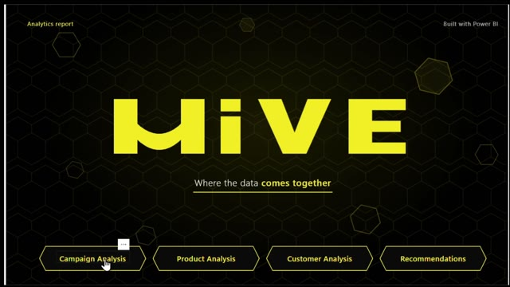
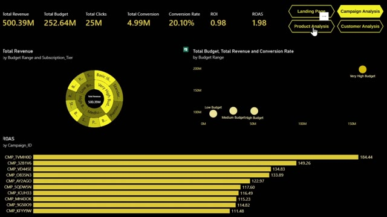
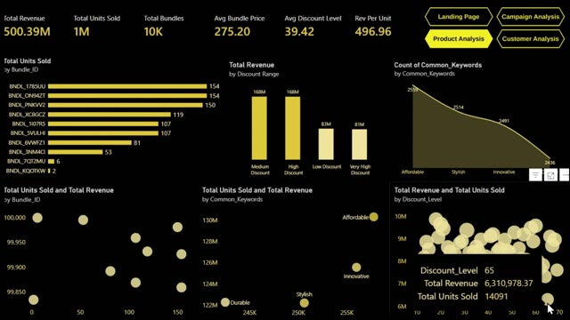
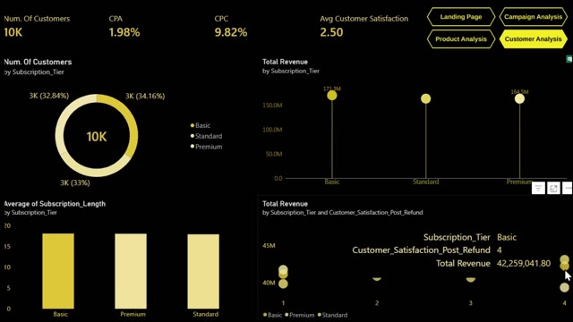
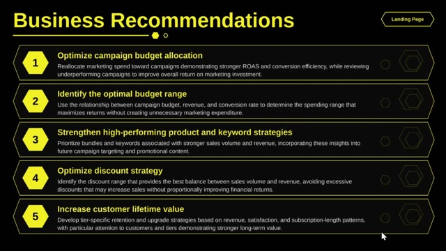

# Hive Analytics — Marketing Performance Analysis

**Tools:** Microsoft Power BI · Power Query · DAX  
**Project Type:** Interactive Marketing Performance Report  
**Dataset:** Simulated business data

## Project Overview

This project presents an interactive, multi-page Power BI report designed to explore marketing performance across campaigns, products, and customers. It brings together campaign effectiveness, budget utilization, product performance, discount strategy, and customer value to support more informed marketing decisions.

## Report Preview

| Custom Landing Page | Campaign Analysis |
|---|---|
|  |  |

| Product Analysis | Customer Analysis |
|---|---|
|  |  |

| Business Recommendations |
|---|
|  |

## Report Structure

- **Custom Landing Page:** Introduces the report and provides navigation to the analysis pages.
- **Campaign Analysis:** Explores revenue, budget, clicks, conversions, conversion rate, ROI, and ROAS.
- **Product Analysis:** Examines revenue, units sold, product bundles, average bundle price, discount levels, and revenue per unit.
- **Customer Analysis:** Reviews customer numbers, customer acquisition cost (CPA), satisfaction, and related customer metrics.
- **Business Recommendations:** Summarizes opportunities for campaign spending, product strategy, discount decisions, and customer retention.

## Key Analytical Areas

- Campaign performance and return on investment (ROI)
- Budget allocation and conversion efficiency
- Product and product-bundle performance
- Discount strategy and revenue optimization
- Customer acquisition and satisfaction
- Customer lifetime value, retention, and engagement opportunities

## Recommendations

1. **Optimize campaign budget allocation** by comparing budget levels with revenue and conversion performance to identify more efficient spending opportunities.
2. **Strengthen high-performing product and keyword strategies** to focus effort on areas showing stronger performance.
3. **Optimize discount strategy** by balancing sales volume with revenue and avoiding discounts that do not generate proportional returns.
4. **Increase customer lifetime value** through retention and upgrade strategies informed by revenue, satisfaction, subscription duration, and customer tier.
5. **Prioritize long-term customer value** by identifying opportunities to improve retention and engagement.

## Technical Skills Demonstrated

- Data cleaning and preparation with Power Query
- DAX measures and KPI calculations
- Data modeling and relationship management
- Marketing campaign and performance analysis
- Product, customer, and discount analysis
- Interactive visualizations and multi-page report design
- Business recommendations and data storytelling

## Explore the Project

- **[Open the published Power BI report](https://app.powerbi.com/groups/me/reports/0d1f9605-625e-4975-9b80-8bc082c246b3/c63c08154cac8de07d45?experience=power-bi)**
- **[Watch the Power BI walkthrough on YouTube](https://youtu.be/1T6BfhMIusY)**
- **[Download the Power BI report (.pbix)](Hive%20Marketng.pbix)**

## Project Reflection

This project strengthened my experience applying business intelligence to marketing performance. It brought together campaign effectiveness, product and customer metrics, and interactive reporting, with a focus on translating analysis into practical recommendations for budget optimization, discount management, and customer retention.

## About Me

**Claudia Al-Amir** | Data Analyst

[LinkedIn](https://www.linkedin.com/in/claudia-al-amir-131199424) · [Email](mailto:claudiaalamir21@gmail.com)
